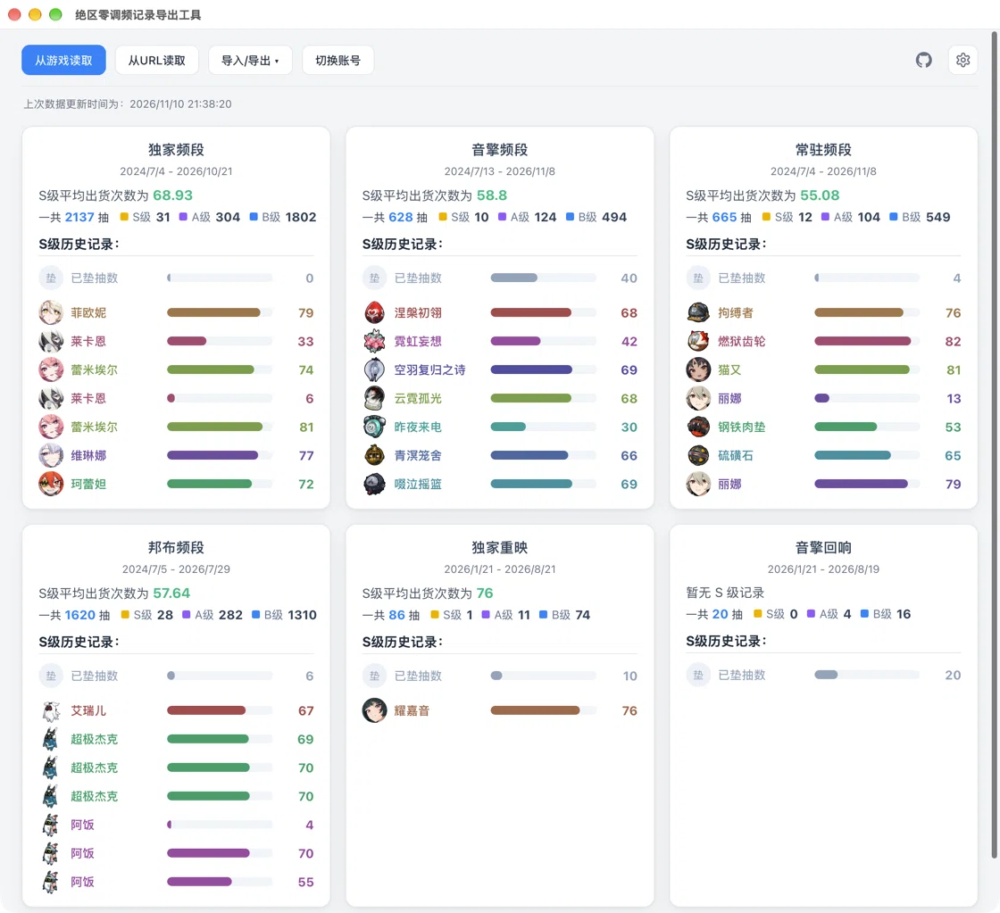

# ZZZ Signal Search Export

[English](README.md) | [简体中文](README.zh-CN.md)

A simple desktop app for exporting your Zenless Zone Zero signal search history on macOS.

The original [zzz-signal-search-export](https://github.com/earthjasonlin/zzz-signal-search-export) is an Electron-based Windows tool, but on macOS, Zenless Zone Zero usually needs to run through an emulator / compatibility layer such as [**Yaagl**](https://github.com/yaagl/yet-another-anime-game-launcher). This project adds support for that setup and has been rewritten with [MyGo](https://github.com/egoist/mygo).

## Status

So far, only **Yaagl on macOS** has been verified on real hardware. Other setups have not been tested yet; feedback is welcome.

## Download

Download the latest release from the [Releases](https://github.com/ykonut/zzz-signal-search-export-mygo/releases) page.

## Usage

1. Open the **Signal Search History** page in Zenless Zone Zero.
2. Launch the app and click **Read from game**.
3. If that does not work, click **Read from URL** and paste a history link.
4. Review your stats, then export to Excel or UIGF if needed.

To manage multiple accounts, open **Settings → Switch account**.

## Acknowledgements

- [earthjasonlin/zzz-signal-search-export](https://github.com/earthjasonlin/zzz-signal-search-export) — the original project and the core functionality this app is based on
- [biuuu/star-rail-warp-export](https://github.com/biuuu/star-rail-warp-export) — the project the original exporter was derived from
- [egoist/mygo](https://github.com/egoist/mygo) — the desktop framework used here
- [qax-os/excelize](https://github.com/qax-os/excelize) — Excel export
- [Enka Network](https://enka.network/) — avatar and weapon icon data
- [Nanoka](https://static.nanoka.cc/) — item and icon data
- [UIGF](https://uigf.org/) — the UIGF data format
- [HoYoverse](https://www.hoyoverse.com/) — Zenless Zone Zero and its assets

Game names, characters and artwork belong to their respective owners. This is an unofficial community project and is not affiliated with HoYoverse / miHoYo.

## License

[MIT](LICENSE)

The core functionality is ported from [earthjasonlin/zzz-signal-search-export](https://github.com/earthjasonlin/zzz-signal-search-export), Copyright (c) 2024 earthjasonlin, under the MIT License.
