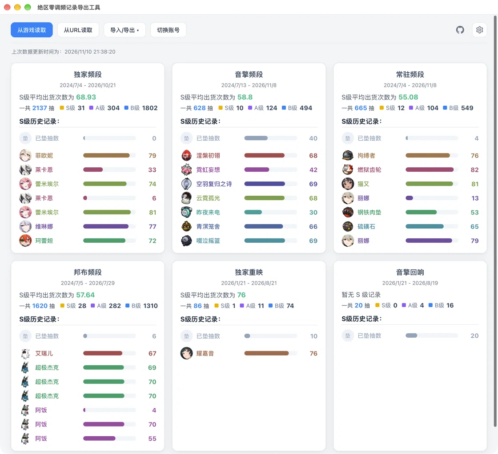

# 绝区零调频记录导出工具

[English](README.md) | [简体中文](README.zh-CN.md)

一个用于导出 macOS 上《绝区零》调频记录的桌面工具。

原项目 [zzz-signal-search-export](https://github.com/earthjasonlin/zzz-signal-search-export) 是一个基于 Electron 的 Windows 工具，但 macOS 上的《绝区零》通常需要通过 [**Yaagl**](https://github.com/yaagl/yet-another-anime-game-launcher) 这类模拟器 / 兼容层运行。本项目新增了对这种运行方式的支持，并基于 [MyGo](https://github.com/egoist/mygo) 重写。

## 状态

目前仅在 macOS 的 Yaagl 上实机验证，其他运行方式尚未测试，欢迎反馈。

## 下载

请前往 [Releases](https://github.com/ykonut/zzz-signal-search-export-mygo/releases) 下载最新版本。

## 使用方法

1. 在《绝区零》中打开「调频记录」页面；
2. 启动应用，点击「从游戏读取」；
3. 如果读取失败，点击「从URL读取」，粘贴调频记录链接；
4. 查看统计结果，需要时导出 Excel 或 UIGF。

多账号可以在「设置 → 切换账号」中管理。

## 致谢

- [earthjasonlin/zzz-signal-search-export](https://github.com/earthjasonlin/zzz-signal-search-export) —— 原项目，本工具的核心功能来源
- [biuuu/star-rail-warp-export](https://github.com/biuuu/star-rail-warp-export) —— 原项目的前身项目
- [egoist/mygo](https://github.com/egoist/mygo) —— 本项目使用的桌面框架
- [qax-os/excelize](https://github.com/qax-os/excelize) —— Excel 导出
- [Enka Network](https://enka.network/) —— 角色头像与武器图标数据
- [Nanoka](https://static.nanoka.cc/) —— 物品与图标数据
- [UIGF](https://uigf.org/) —— UIGF 数据格式
- [HoYoverse](https://www.hoyoverse.com/) —— 《绝区零》游戏及素材

游戏名称、角色和美术素材的版权归其各自权利人所有。本项目为非官方社区项目，与 HoYoverse / miHoYo 无关联。

## 许可证

[MIT](LICENSE)

核心功能移植自 [earthjasonlin/zzz-signal-search-export](https://github.com/earthjasonlin/zzz-signal-search-export)，Copyright (c) 2024 earthjasonlin，采用 MIT License。
